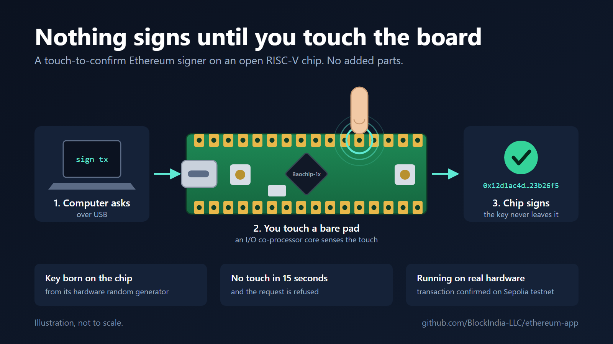

# Ethereum burner for dabao

`eth-burner` is an Ethereum signer for a bare [dabao](../../xous-core/apps-dabao/README.md) (Xous on a
bao1x, no screen): a burner wallet with no PIN and no recovery phrase, which signs only when the pad
`PB1` is touched.



## Why open hardware

We verify our software. We still take our chips on faith.

Every wallet, password manager and secure login rests on a chip that nobody outside the manufacturer can
inspect. The code on top can be open source and audited line by line, and it still runs on a black box. If
the silicon has a flaw or a backdoor, no amount of software review will find it. Open hardware changes the
question from "do you trust the vendor?" to "can you check?"


The Baochip-1x that this signer runs on is a RISC-V microcontroller where that checking is possible at each
layer:

* The chip's design source is published.
* The package lets you image the silicon under infrared light and compare it with that design.
* The bootloader can be rebuilt from source and matched, hash for hash, against what the chip reports.
  This was done for the test board: [docs/VERIFICATION.md](docs/VERIFICATION.md).
* The operating system, Xous, is open and written in Rust.

It isn't entirely open: some third-party blocks inside the chip are closed, and they are documented as
closed. The left column of the picture is a generalisation; some commercial chips publish more than that.

What this signer adds on top is small and concrete:

* The private key is made by the chip's own hardware random number generator and never leaves it.
* Nothing is signed until a finger touches a bare pad on the board. No part is added: one of the chip's I/O
  co-processor (BIO) cores measures the touch.
* No touch within 15 seconds, and the request is refused.

It runs on a real board. A transaction signed by it is confirmed on the Sepolia test network:
[`0xdd4a2bfe…e7835b84`](https://sepolia.etherscan.io/tx/0xdd4a2bfe3d43b7757218c0c065b9a6da3c3ac6c1536d0fe2f421af15e7835b84)
(signed with 0.1.0, before the touch was required).

What it does not do yet: show what is being signed. The touch says "sign", not "sign this". A display is
the next step.

The pictures in `docs/` are illustrations, not photographs of the board or of its silicon.

## How it works

The host talks to it over a single vendor-defined USB HID interface (xous-core's
`--feature usb-bao1x/generic-hid`, on its `dabao-burner` branch) or, in the emulator, over a TCP socket.
Messages are `length (u32 BE) || type || CBOR`; see [`protocol.cddl`](protocol.cddl).

* On the first boot it creates a random seed (32 bytes of BIP-39 entropy, the equivalent of a 24-word
  phrase) from the chip TRNG: the TRNG service and the kernel's hardware entropy pool, mixed with SHA-256.
  It is stored in keystore application slots 132 (entropy) and 133 (`ETHBURN1` and a SHA-256 check,
  written last); later boots load it.
* The seed is never shown or exported: whatever the burner holds can't be recovered elsewhere.
* get-version and get-address (any path) are answered at once. Transactions, EIP-712 typed data and
  EIP-191 messages are signed only after a touch on pad `PB1`, see [Touch to confirm](#touch-to-confirm)
  (a request whose `address` isn't this key is refused at once, without waiting). **The touch says "sign",
  not "sign this": nothing shows what is being signed. Test networks and small amounts only.**
* The address at `m/44'/60'/0'/0/0` is logged at boot (serial console).
* In the emulator the seed lives in a host file, `target/eth-burner-seed.bin` in this crate or
  `$ETH_BURNER_SEED`; delete it for a new burner. On the device a new seed needs slots 132..133 erased.

## Touch to confirm

A signing request waits up to 15 seconds for a fingertip on the bare pad `PB1` (BIO pin 1); no part is
added to the board. A BIO core measures how long the pad takes to charge through its pull-up
(`bio-lib`'s captouch), which a finger makes longer.

* The untouched level is measured when the request arrives, so a finger already on the pad approves
  nothing: it has to leave and come back. On a dabao the pad idles at a steady 49 (51 at most) and a
  fingertip reads 55 to 200; three readings in a row above idle + 10 % (at least 5) make a touch.
* No touch in time: error 1 (`user-rejected`), with what the sensor saw in the message.
* If the sensor can't be set up, every signing request is refused with error 6 (`not-ready`).
* In the emulator a file stands in for the touch: create `target/eth-burner-approve` in this crate (or
  `$ETH_BURNER_APPROVE`) after the request is sent; it is removed when used, and one created earlier
  doesn't count. `ETH_BURNER_CONFIRM_MS` changes the 15 s.

Two development commands (see `protocol.cddl`) help on a board without a serial console:
`probe-confirm` returns the lowest and highest sensor reading of the next half second, to find the pad
and tune the level, and `reboot` restarts the chip, which lands in the bootloader's mass storage mode so
new firmware can be copied without pressing a button.

## Two processes

The signer is two Xous processes, built from this one crate:

| | `eth-burner`, the front desk | `eth-approver` |
|---|---|---|
| Talks to the host (USB HID) | yes | no |
| Parses the framing; answers get-version | yes | no |
| Holds the seed, derives keys, signs | no | yes |
| Reads the touch pad and decides "approved" | no | yes |

The front desk hands each request to the approver through one message type (`src/ipc.rs`): a buffer
holding the request as it came from the host, lent while the approver works on it and returned holding
the answer. The approver registers its name with xous-names for a single connection, which the front desk
takes, so no third process can get one.

Xous gives each process its own address space, and on the bao1x the chip's MMU enforces it. The code that
faces the host is the code most likely to have a memory-safety bug; in one process, such a bug could read
the seed or jump past the touch check. Split this way it can only do what the front desk can do: ask the
approver to handle a request, which for a signature still waits for a finger on the pad.

### The keystore, sealed

Separate memory is not enough by itself. On a stock dabao image the keystore registers for unlimited
connections (the `baosec` configuration limits it to a known list), and the application key slots have no
per-process check: a front desk that was fully taken over could connect to the keystore and read slots
132..133, the seed, without going through the approver.

Our xous-core fork adds a keystore feature, `single-client`
([branch `dabao-keystore-single-client`](https://github.com/BlockIndia-LLC/xous-core/tree/dabao-keystore-single-client)):
the dabao's keystore then accepts one connection. The approver makes it at boot, before it starts
answering the front desk, and xous-names refuses every later request. On this image nothing else uses the
keystore.

The `status` command shows it from the board. At boot the approver tries a second connection, and the
front desk tries a first one, as a taken-over front desk would:

| Image | Approver | Front desk |
|---|---|---|
| stock keystore | connected, but this keystore accepts other processes too | the keystore ACCEPTED a connection |
| `--feature keystore/single-client` | holds the keystore's only connection | the keystore refused a connection |

Both rows were read from the test board (0.5.0).

What the split still does **not** do:

* **The pin and BIO services are open.** They register for unlimited connections too: a front desk that was
  taken over could reconfigure pad `PB1` through `bao1x-hal-service` and disturb what the touch sensor
  reads. Not addressed.
* **Trust on first use.** The seal holds because the approver connects before anything else can ask. A
  process that got to the keystore first would hold the one connection instead; the approver would then
  wait for ever and nothing would be signed.
* **It doesn't show what is signed.** The front desk passes on whatever the host sends; a touch approves
  it unseen.
* A bug in the approver itself is still fatal. It is the smaller part: it never parses the HID framing,
  but it does decode the request it is asked to sign.

So the seed is out of the front desk's reach by both routes, memory and keystore, and the split is the
structure that a display owned by the approver would complete.

## Build and run

With xous-core (branch `dabao-burner`) checked out next to `ethereum-app`, and the Xous toolchain installed
(`cargo xtask install-toolkit` in xous-core):

```sh
./build.sh               # host and device binaries (or ./build.sh emu / ./build.sh device)

# emulator: only the base services (ticktimer, log, names), then the two processes
cd ../../xous-core
cargo xtask dabao-emu ../ethereum-app/dabao-app-eth-burner/target/release/eth-approver \
    ../ethereum-app/dabao-app-eth-burner/target/release/eth-burner
# in another terminal, from this directory
tools/eth_client.py get-version
tools/eth_client.py get-address "m/44'/60'/0'/0/0"
# each sign command waits for its approval: `touch target/eth-burner-approve` once it is sent
tools/eth_client.py sign-tx --expect <the address logged at boot>
tools/eth_client.py sign-typed-data mail --expect <address>    # EIP-712; also `group` or a JSON file
tools/eth_client.py sign-message 'Hello' --expect <address>    # EIP-191; also siwe or 0xHEX

# device image: the app paths must come before the flags
cargo xtask dabao ../ethereum-app/dabao-app-eth-burner/target/riscv32imac-unknown-xous-elf/release/eth-approver \
    ../ethereum-app/dabao-app-eth-burner/target/riscv32imac-unknown-xous-elf/release/eth-burner \
    --feature usb-bao1x/generic-hid
tools/eth_client.py --hid get-address    # needs `pip install hidapi`
```

`tools/eth_client.py` has no dependencies for TCP (minimal CBOR, RLP, Keccak-256 and secp256k1 recovery in
`tools/ethlib.py`, which also implements EIP-191 and EIP-712 hashing: the sign commands print the expected
hashes and recover the signer from the returned signature); `--hid` uses `hidapi` and opens
VID 0x1d50 / PID 0x6197. `ETH_BURNER_PORT` changes the emulator's TCP port (default 7600).

## Reproduce it from scratch

These are the steps the firmware on the test board was built with, on a clean Linux machine (a GitHub
Codespace, 4 cores; nothing is installed on the PC the board is plugged into).

Rust is pinned to 1.99.1. With 1.100.0 the last step fails with `Error: Os { code: 2, kind: NotFound }`:
Cargo changed where build scripts write their output, and this xous-core's `xtask` no longer finds the
`SVD_PATH` file that `utralib` leaves there.

```sh
# 1. the two repositories, side by side
git clone --branch dabao-keystore-single-client https://github.com/BlockIndia-LLC/xous-core.git   # devcon8-workshop (d1d4b9b) + 1 commit
git clone --branch touch-confirm    https://github.com/BlockIndia-LLC/ethereum-app.git

# 2. Rust, and the version tags the Xous build checks for
#    (1.99.1, not the latest: see the note below)
curl --proto '=https' --tlsv1.2 -sSf https://sh.rustup.rs | sh -s -- -y --profile minimal --default-toolchain 1.99.1
. "$HOME/.cargo/env"
cd xous-core
git remote add upstream https://github.com/betrusted-io/xous-core.git
git fetch upstream --tags

# 3. the Xous target for Rust (downloaded from betrusted-io/rust releases)
cargo xtask install-toolkit

# 4. the signer, for the emulator and for the board
cd ../ethereum-app/dabao-app-eth-burner
./build.sh
cargo test --release

# 5. the board image: loader.uf2, xous.uf2 and apps.uf2 in
#    xous-core/target/riscv32imac-unknown-xous-elf/release/
cd ../../xous-core
R=../ethereum-app/dabao-app-eth-burner/target/riscv32imac-unknown-xous-elf/release
cargo xtask dabao $R/eth-approver $R/eth-burner --feature usb-bao1x/generic-hid --feature keystore/single-client
```

Without `--feature keystore/single-client` the image has the stock keystore, open to every process (see
"The keystore, sealed").

The images are signed with the public developer key. A bao1x that boots one erases its factory secrets
and counts itself, for good, as a developer device.

To load them, put the board in its bootloader (hold `PROG`, tap `RESET`, release `PROG`): it shows up as a
USB drive named `BAOCHIP`. Copy the three files onto it, then press `PROG` to start. With 0.3.0 or later
already running, the `reboot` command replaces the buttons.

These steps were replayed as written, on 2026-11-17, on a new Codespace with no Rust on it: they ran to
the end in under seven minutes, and the three files they produced were flashed to the test board, where
the signer answered as 0.5.0 with the same address and a sealed keystore. (The first replay is what found
the Rust version problem above.)

The replay does **not** give the same bytes. Rebuilding in the same directory on the same machine left
`loader.uf2` unchanged and changed `xous.uf2`, most likely through the build timestamp; the replay, in
another directory on another machine, gave different files for all three, probably because source paths
end up in the binaries. So this shows the steps work, not that the firmware on a board can be matched to
the source. For these images, xous-core's `--no-timestamp` flag and a [baobit](https://github.com/sbellem/baobit)
(Guix) build are the way to that, and have not been tried; the boot stages below them were matched, see
[docs/VERIFICATION.md](docs/VERIFICATION.md).

### Browser page

`tools/web/index.html` is a one-file wallet page that talks to the board over WebHID, in Chrome or Edge on a
computer. Nothing is installed.

* **Connect** shows the signer's version, the board's address and its Sepolia balance.
* **Sign a message** and **Send a test transaction** ask the board, show a "touch the pad" banner with a
  countdown, then recover the signer from the reply and compare it with the board's address. A transaction
  is only sent to the network by a separate Broadcast button.
* **Check the bootloader** restarts the board into its bootloader (`reboot`), reads the `audit` output over
  Web Serial and compares the two boot stages' SHA-512 with builds that were rebuilt from source
  ([docs/VERIFICATION.md](docs/VERIFICATION.md)), then starts the signer again. The list of known builds is
  in the page (`KNOWN_BUILDS`) and has one entry so far, `v0.10.0-61-g5397e1b48`; any other version is
  reported as not in the list. Someone using the page trusts that list, and the chip's own report.
* A live meter of the touch sensor (`probe-confirm`).

Browsers give WebHID only to pages served over https or from `localhost`, not to a file opened from disk:
`pwsh -File tools/web/serve.ps1` serves the folder at `http://localhost:8765/` (this computer only), and
`python3 -m http.server 8765` in that folder does the same.

The page is fixed to the Sepolia test network. It shows what it asks the board to sign, but the board has
no screen: a compromised computer could ask for something else. It loads `ethers` 6.13.4 from a public CDN
for the Ethereum encoding and the signature checks.

### Windows host tools

`tools/windows` holds PowerShell scripts that talk to the board with Windows' own HID support: no Python,
no driver, nothing to install (PowerShell 7).

| Script | What it does |
|---|---|
| `dabao-flash.ps1 -Dir <folder> [-AppsOnly]` | asks the signer to reboot, waits for `BAOCHIP`, copies the firmware, starts it and prints the running version |
| `dabao-sign-hello.ps1` | sends an EIP-191 request for `Hello`; touch `PB1` to approve |
| `dabao-touch-meter.ps1` | shows the touch sensor's reading twice a second (`probe-confirm`) |
| `dabao-hid-send.ps1 -Hex <type and message>` | sends one raw request and prints the reply |

They don't check signatures: the signer of a reply was recovered with `tools/ethlib.py`.

## Hardware tests

The checks to run on a real board are in xous-core's
[apps-dabao/HARDWARE-TESTS.md](../../xous-core/apps-dabao/HARDWARE-TESTS.md). Run so far on one dabao
(stepping A0), from a Windows host through raw HID reports:

* 0.1.0: get-version, get-address, sign-message and an EIP-1559 sign-tx, each answered in 80 to 200 ms
  with the signer recovered; the address was the same after reflashing. One such transaction was
  broadcast on Sepolia:
  `0xdd4a2bfe3d43b7757218c0c065b9a6da3c3ac6c1536d0fe2f421af15e7835b84`.
* 0.3.0: sign-message is refused after 15 s without a touch and signed after a touch on `PB1`;
  `probe-confirm` and `reboot` work.
* 0.4.0, as two processes: get-version (front desk) and get-address (approver, same address as before);
  `probe-confirm` reads the pad; sign-message is refused after 15 s without a touch and signed after one; a request naming
  another address is refused at once (159 ms).
* 0.5.0: `status` on a stock image and on a `keystore/single-client` image, as in "The keystore, sealed".
  On the sealed image: get-address (same address, so the approver reads the seed), `probe-confirm`, and
  sign-message refused after 15 s without a touch and signed after one (from the browser page, which
  also showed the two `status` lines).

Not run on a board yet: sign-typed-data, a second board.

## Layout

| Path | Role |
|---|---|
| `src/main.rs` | `eth-burner`, the front desk: transport, and passing requests to the approver |
| `src/approver.rs`, `src/signer.rs` | `eth-approver`: seed creation and storage (keystore slots or a host file), request handling and signing |
| `src/ipc.rs` | the one message between the two processes |
| `src/lib.rs` | the modules shared by the two binaries |
| `src/confirm.rs` | approval of a signing request: touch pad (device) or a file (emulator) |
| `src/protocol.rs` | framing, custom CBOR, HID chunking (unit tested) |
| `src/transport.rs` | HID (device) and TCP (emulator) transports; answers get-version |
| `protocol.cddl` | protocol definition |
| `tools/eth_client.py`, `tools/ethlib.py` | host client and its Ethereum helpers |
| `tools/web/` | browser wallet page (WebHID) and a local server for it |
| `tools/windows/*.ps1` | Windows host scripts: flash, sign, touch meter, raw requests |
| `docs/` | illustrations for this README |
