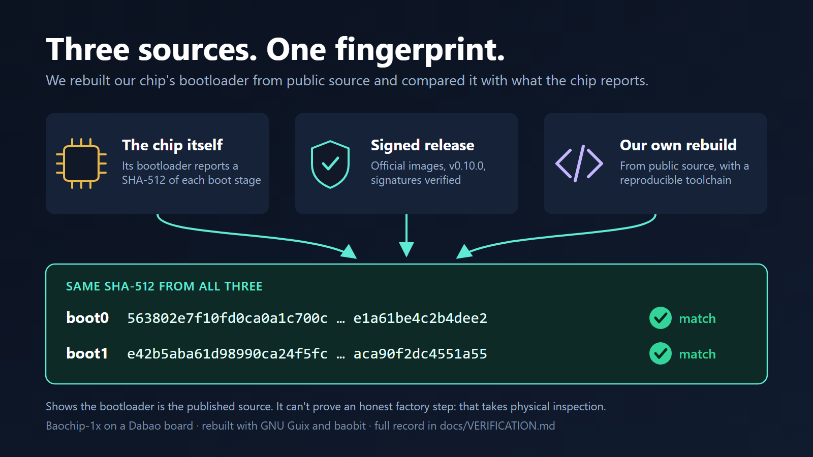

# Checking the bootloader of the test board against the public source

The dabao this signer was developed on reports, through its bootloader's `audit` command, a SHA-512 of
the two boot stages it holds. This is a record of rebuilding both stages from the public source and
comparing, following [baobit's VERIFY.md](https://github.com/sbellem/baobit/blob/main/VERIFY.md).



**Result: all three sources agree, for both stages.**

| | boot0, code only (SHA-512) | boot1, code only (SHA-512) |
|---|---|---|
| The board's `audit` | `563802e7…c2b4dee2` | `e42b5aba…c4551a55` |
| Official signed release v0.10.0 (presign hash) | `563802e7…c2b4dee2` | `e42b5aba…c4551a55` |
| Rebuilt from source here | `563802e7…c2b4dee2` | `e42b5aba…c4551a55` |

Full values:

```
boot0  563802e7f10fd0ca0a1c700c6313eff624aa57d9cd88d3c33af4b720eff5480432e01c116925a324a96e12d92953d7cb6076ea4557a22058e1a61be4c2b4dee2
boot1  e42b5aba61d98990ca24f5fc3b6cf012b14ea4d121f9bbe494baf4d9ae854d3ba88cdf26a288b88778826f816dc960c3ffe24b7c919108a3aca90f2dc4551a55
```

## What was compared

**1. The board.** A dabao, stepping A0, bootloader `v0.10.0-61-g5397e1b48`. Its `audit` (read over the
bootloader's USB serial console on 2026-11-12, before any developer image was loaded) gave the two
"code only" hashes above, named `441559d7e1984623ec0a52f60f90240c740b6c41` as the baobit toolchain of
both stages, and reported `Boot0: key 0/0 (bao1)` and `Boot1: key 0/0 (bao1)`. It also gave the hashes
of the whole partitions:

```
boot0 partition  a0680a73106600c4ece34f9393fc5c8eed4885e844b1b78b58fb3a8a299a885cd794c667a5e787083bce46bf7aff8d3f4affa6a93a38ba7b507bb0d47c70fa01
boot1 partition  a12eb17f37c88e834bb7beef3f5163f232824e8044fcbab3bb37c6ac54d10f78d61ace96da9ebfc03e3cc9514312f22b18a9481747fc0526dc89733789db3927
```

**2. The official release.** `bao1x-boot0.img` and `bao1x-boot1.img` from
`https://ci.betrusted.io/releases/v0.10.0/baochip/bootloader/`, checked with baobit's `verify-binary`
(baobit commit `f68849e`):

* `Verification: PASSED` for both, signing key `a87a5f98…409523a (bao1)`;
* `Presign SHA512` equal to the board's "code only" hashes;
* `Padded SHA512` equal to the board's partition hashes.

**3. The rebuild.** With GNU Guix and the channel file for the commit the board names:

```sh
curl --proto '=https' --tlsv1.2 -sSfLo baobit.scm \
  https://raw.githubusercontent.com/sbellem/baobit/refs/heads/main/channels/baobit.441559d7.scm
guix time-machine --channels=baobit.scm -- build bao1x-boot0 --root=boot0
guix time-machine --channels=baobit.scm -- build bao1x-boot1 --root=boot1
sha512sum boot0/bao1x-boot0-presign.img boot1/bao1x-boot1-presign.img
```

```
boot0 -> /gnu/store/0d18xr4wlwkhycz6m96ds60mk2w9vc22-bao1x-boot0-v0.10.0-61-g5397e1b48
boot1 -> /gnu/store/03i2nbkbw6vy8a1w9574s75ziswfnb9i-bao1x-boot1-v0.10.0-61-g5397e1b48
boot0/bao1x-boot0-presign.img: OK
boot1/bao1x-boot1-presign.img: OK
```

Only the presign images are compared: the rebuilt `.img` files are signed with the developer key, so
they differ from the official, `bao1`-signed ones, as expected.

## How the rebuild was run, and where it departs from the guide

* On a GitHub Codespace (Ubuntu 24.04, 4 cores, 16 GB), with Guix 1.4.0 from the Ubuntu package as the
  starting point for `guix time-machine`.
* **The build sandbox was off** (`guix-daemon --disable-chroot`): the container doesn't allow it. Builds
  could therefore see the host's files. The hashes still came out equal, which is the point of the check,
  but this is a weaker setup than a normal Guix installation.
* Substitutes (prebuilt packages) from `ci.guix.gnu.org` and `bordeaux.guix.gnu.org` were used for the
  common packages. The RISC-V cross compiler, the Rust 1.90.0 sysroots, the Xous toolchain and the two
  boot stages were built here.
* It took two runs: the first was cut short when the Codespace stopped for inactivity, the second (about
  45 minutes, 2026-11-17) resumed from what was already in the store.
* One build, on one machine. It was not repeated with `--check` or on a second machine.

## What this does and doesn't show

It shows that the two boot stages this board reports are, byte for byte, what the published source
builds, and that they are the officially signed v0.10.0 images.

It does not show more than baobit's
[trust model](https://github.com/sbellem/baobit/blob/main/VERIFY.md#trust-model) allows, and on this board
less:

* The hashes are computed by the `boot1` that is on the board. Here that `boot1` came from the factory:
  it was not built and installed by the person checking, so its honesty is assumed, not established.
* Everything rests on an honest chip-probe (factory provisioning) step, which no software check can test.
* The board is pre-production (A0) silicon; whether `boot0` is write-locked on it was not checked.
* That the chip returns the true contents of its memory when read is a hardware assumption. Physical
  inspection (IRIS) addresses it; that was not done here.
* It says nothing about the Xous image or the signer, which on this board are developer-signed builds
  from this repository (see the README for how they are built).
